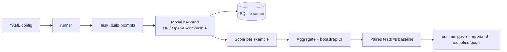

# evalkit: an LLM evaluation harness you can read in an afternoon

[](https://github.com/kishorhange111/llm-evaluation-harness/actions/workflows/ci.yml)


Benchmarks for large language models with the statistics most leaderboards leave out: every score has a 95 % confidence interval, every model comparison has a paired significance test, and the harness is checked against EleutherAI's lm-evaluation-harness on the same model.

**Author:** Kishor Hange

<!-- RESULTS:START -->
## Results

_The Colab runs for this section are in progress. This section will hold: the validation against lm-evaluation-harness, Qwen2.5 0.5B → 7B scaling on MMLU / ARC / HellaSwag / GSM8K / HumanEval, prompt sensitivity, and the LLM-judge position-bias study._
<!-- RESULTS:END -->

## What it does

| Area | What is implemented | Why it matters |
|---|---|---|
| Multiple choice (MMLU, ARC, HellaSwag) | Log-likelihood scoring of each option, `acc` and length-normalised `acc_norm`, few-shot prompts per subject | The standard way leaderboards score base models; no generation, no parsing errors |
| Generation (GSM8K, HumanEval, custom JSONL) | Batched, left-padded generation, stop sequences, chat templates | Instruct models are used through chat templates, so they should be evaluated that way |
| Code execution | Each program runs in an isolated `python -I` subprocess with a timeout, memory cap and empty environment | Model-written code is untrusted |
| pass@k | The unbiased estimator from the Codex paper | Naive "k samples, any correct" is biased upward |
| Statistics | Bootstrap 95 % CIs; paired bootstrap and McNemar's test between models | A 1-point gap on 1,000 questions is often noise |
| LLM-as-judge | Pairwise judging in both orders; a verdict counts only if it survives the swap | Judges prefer whichever answer they read first |
| Backends | Hugging Face `transformers`, any OpenAI-compatible server (vLLM, TGI, Ollama), and a dummy model for tests | Same task code for local and served models |
| Response cache | SQLite cache keyed by model, request and settings | A crashed or preempted run resumes without recomputing |

## How a run works



Every example's prompt, prediction, target and score is written to `samples/`, so any number in a report can be traced back to the exact model outputs behind it.

## Quickstart

```bash
pip install -e ".[hf]"                      # torch, transformers, datasets
evalkit list                                # available tasks
evalkit run configs/smoke.yaml --limit 10   # a two-minute end-to-end check
evalkit report results/smoke                # re-render the markdown report
```

A config names the models and tasks:

```yaml
run_name: qwen25_scaling
models:
  - {backend: hf, pretrained: Qwen/Qwen2.5-0.5B-Instruct, chat: true, batch_size: 64}
  - {backend: hf, pretrained: Qwen/Qwen2.5-7B-Instruct, chat: true, batch_size: 32}
tasks:
  - {name: mmlu, num_fewshot: 5}
  - {name: gsm8k, chat: true}
  - {name: humaneval, chat: true}
```

The first model is the baseline for the paired tests. To evaluate a model behind an OpenAI-compatible server, see `configs/example_openai_server.yaml`.

On Google Colab, `scripts/colab_job.sh` clones the repo, installs it and runs any list of configs; results are packed into `/content/results.tgz` even if a step fails.

## Correctness details that change scores

- **Tokenisation boundary.** `tok(context + continuation)` is not `tok(context) + tok(continuation)` for BPE tokenisers. Continuation tokens are taken from the joined string, and a trailing space moves from the context to the continuation (`"Answer:" + " B"`).
- **Only the needed logits.** Sequences are left-padded so every continuation ends in the last columns, and the model projects only those positions onto the 152k-word vocabulary. Projecting every position of a 5-shot MMLU batch would need tens of GB.
- **BOS tokens.** Llama- and Gemma-style models expect a beginning-of-sequence token; it is added exactly when the tokenizer itself would add one.
- **Primary metric everywhere.** HellaSwag is reported as `acc_norm`, so its confidence interval and significance tests are computed on `acc_norm` too.

## Project layout

```
src/evalkit/
├── models/        hf.py (local), openai_compat.py (served), dummy.py (tests)
├── tasks/         mmlu / arc / hellaswag, gsm8k, humaneval, custom JSONL
├── metrics/       text matching, bootstrap + McNemar, pass@k, LLM judge
├── sandbox.py     isolated code execution
├── cache.py       SQLite response cache
├── runner.py      config → results, CIs, paired tests
└── cli.py         evalkit run | list | report
configs/           smoke, scaling, prompt sensitivity, lm-eval validation
scripts/           Colab job, judge experiment, lm-eval comparison
tests/             CPU-only tests, including a tiny GPT-2 built locally
```

## Tests

```bash
pip install -e ".[dev]" torch transformers
pytest
```

The tests run on CPU without downloads. They cover batched log-likelihoods against an unpadded reference computation, batched generation against unbatched, token-budget batching, metric formulas checked by hand, the sandbox (timeouts, memory cap, thread safety, environment isolation), the judge's position-swap logic and the cache.

## Limitations

- Single-GPU only; data-parallel evaluation across GPUs is not implemented.
- Benchmarks are the public test sets, which may appear in models' training data.
- The code sandbox is defence in depth, not a security boundary; run untrusted evaluations inside a container without network.

## License

MIT
