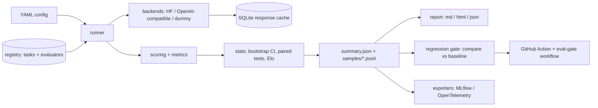

# Architecture

| Layer | Modules | Responsibility |
|---|---|---|
| Orchestration | `runner`, `cli`, `registry` | Load config, resolve tasks/backends, cache, write results |
| Evaluators | `tasks/`, `metrics/` | Benchmarks, RAG metrics, agent trajectories, JSON-schema checks, red-team, rubric judge |
| Statistics | `stats/`, `arena` | Bootstrap and BCa intervals, paired tests, Elo / Bradley-Terry |
| Reproducibility | `datasets`, `cache` | Dataset manifests with SHA-256 hashing and diffs; resumable runs |
| Reporting | `report`, `exporters` | Markdown/HTML/JSON reports, MLflow and OpenTelemetry export |
| Governance | `regression`, `action.yml` | Blocking regression thresholds locally and in CI |

Decisions are recorded in [`docs/adr/`](adr). The CI action is described in [github-action.md](github-action.md).
